  

# Hi, I'm Meryeme 👋

AI/ML engineering student at **ENSIAS** (Rabat, AI track). I build LLM and ML systems end to end, and I spend most of my time on the parts that make them trustworthy: evaluators, held-out sets, calibration and confidence intervals.

**Looking for an ML / AI engineering internship in France for summer 2027.**

[Portfolio](https://meryemeramdisportfolio.netlify.app) · [LinkedIn](https://www.linkedin.com/in/meryeme-ramdi) · [dev.to](https://dev.to/meryyy) · [Email](mailto:meryemeramdi05@gmail.com)

---

## Selected work

| Project | What it does | Result |
|---|---|---|
| **Pulsar Modernizer** R&D internship · Pulsaride *(private code)* | A local LLM extracts business intents and rules from legacy Java; three chained agents then regenerate modern Spring Boot code. | F1 0.857 (×4 vs in-house baseline) · ÷3 latency · [article](https://dev.to/meryyy/the-day-i-asked-three-llm-agents-to-rewrite-legacy-java-for-me-and-what-actually-happened-2jda) |
| [**QraLia**](https://github.com/ousyas/QraLia) pair project | Multilingual RAG assistant (French, Arabic, Darija) that explains utility bills from cited official sources, and abstains when unsure. | Hybrid BM25 + Qwen3 retrieval with reranking: Recall@5 0.981 on 227 test questions |
| [**Sanabils**](https://github.com/zakeelm6/bcg-hack-agri-advisor) team of 5 | Farming advisor for smallholders. I built the rule-based decision engine (water balance, capped doses, plan B) and the simulated soil sensors. | 🥉 3rd place, BCG Platinion Hackathon 2026 |
| [**Misdiagnosis Detector**](https://github.com/Meryy4/misdiagnosis-detector) | Contrastive learning on PubMedBERT to flag symptom/diagnosis inconsistencies, with a calibrated "please verify" zone. | AUC 0.72 → 0.92 · 94% accuracy at 56% coverage · [demo](https://huggingface.co/spaces/meryy4/misdiagnosis-detector) · [article](https://dev.to/meryyy/how-i-built-an-ai-that-tells-doctors-wait-are-you-sure-17jm) |
| [**Offline A/B Test Simulator**](https://github.com/Meryy4/offline-ab-simulator) | Estimates how a new recommendation policy would perform, from logs only, without deploying it. | IPS, SNIPS and Doubly Robust estimators with reliability diagnostics and 95% CIs |
| [**SensoGuide**](https://github.com/Meryy4/SensoGuide) | Real-time scene description for visually impaired users: object detection, LLM narration, Latin and Arabic OCR, voice commands. | YOLOv8 fine-tuned on 35 classes (mAP50 0.86) · demoed live to 200+ visitors |

**Now building:** [ORBIT](https://github.com/Meryy4/orbit-astronaut-health), autonomous health monitoring for astronauts on long missions (NASA Space Apps 2026).

**For fun:** [If this book were a cat](https://github.com/Meryy4/Books-cat): each cat is drawn by code from the emotional analysis of a public-domain novel, and every trait is explained.

## Writing

- [The day I asked three LLM agents to rewrite legacy Java for me, and what actually happened](https://dev.to/meryyy/the-day-i-asked-three-llm-agents-to-rewrite-legacy-java-for-me-and-what-actually-happened-2jda)
- [How I built an AI that tells doctors "Wait... are you sure?"](https://dev.to/meryyy/how-i-built-an-ai-that-tells-doctors-wait-are-you-sure-17jm)

## Toolkit

- **ML / LLMs:** Python · PyTorch · scikit-learn · XGBoost · Hugging Face · sentence-transformers · LangChain · Ollama · QLoRA
- **Evaluation:** causal inference (IPS · SNIPS · DR) · calibration · bootstrap CIs · LLM-as-judge
- **Backend & infra:** FastAPI · Spring Boot · PostgreSQL · Docker · Streamlit
- **Languages:** Arabic · French · English
